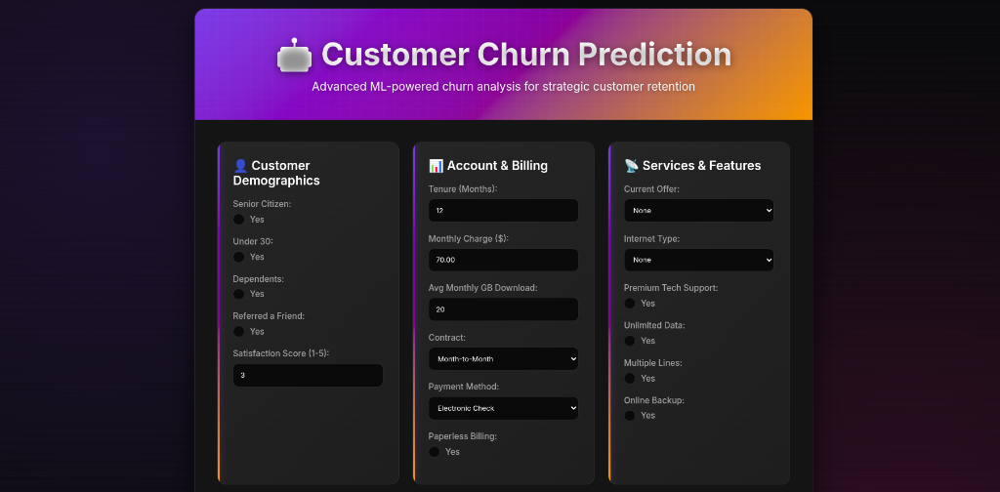

# 🤖 Customer Churn Prediction Web App

A modern, dark-themed web application for predicting customer churn using machine learning. Built with FastAPI and powered by a Random Forest classifier.




## ✨ Features

- 🎯 **Accurate Predictions** - Random Forest model with probability estimates
- 🌙 **Modern Dark UI** - Beautiful, responsive interface with animations
- 📊 **Detailed Analytics** - Shows both churn risk and retention probability
- 🚀 **Fast API** - Built with FastAPI for high performance
- 📱 **Mobile Friendly** - Responsive design works on all devices
- 🔒 **Type Safe** - Full type validation with Pydantic

### Prediction Form
Clean, organized form with sections for:
- 👤 Customer Demographics
- 📊 Account & Billing
- 📡 Services & Features
- 🎬 Entertainment Services

### Results Display
Shows comprehensive prediction results:
- Final prediction (Will Churn / Will Not Churn)
- Prediction confidence percentage
- Churn risk breakdown
- Retention probability

## 🚀 Quick Start

### Prerequisites
- Python 3.11+
- pip

### Installation

1. **Clone the repository**
```bash
git clone https://github.com/yourusername/churn-prediction.git
cd churn-prediction
```

2. **Create virtual environment**
```bash
python -m venv venv
source venv/bin/activate  # On Windows: venv\Scripts\activate
```

3. **Install dependencies**
```bash
pip install -r requirements.txt
```

4. **Run the application**
```bash
python run.py
```

5. **Open your browser**
```
http://localhost:8000
```

## 📁 Project Structure

```
churn-prediction/
├── main.py                      # FastAPI application
├── run.py                       # Simple run script
├── best_model_pipeline.pkl      # Trained ML model (2.3MB)
├── requirements.txt             # Python dependencies
├── templates/
│   └── index.html              # Web interface
├── test_model.py               # Model testing script
├── inspect_model.py            # Model inspection utility
├── .env                        # Environment variables
├── .gitignore                  # Git ignore rules
├── Procfile                    # Heroku/Render deployment
├── runtime.txt                 # Python version
├── render.yaml                 # Render.com config
├── vercel.json                 # Vercel config
├── DEPLOYMENT.md               # Deployment guide
└── README.md                   # This file
```

## 🎮 Usage

### Web Interface

1. Fill in customer information across four sections
2. Click "🔮 Analyze Customer Risk"
3. View prediction results at the top of the page

### API Endpoints

#### Health Check
```bash
GET /health
```

#### Web Form
```bash
GET /
```

#### Prediction (Form)
```bash
POST /predict
```

#### Prediction (API)
```bash
POST /api/predict
Content-Type: application/json

{
  "senior_citizen": "No",
  "under_30": "Yes",
  "dependents": "No",
  "tenure_in_months": 24.0,
  "monthly_charge": 85.50,
  ...
}
```

### API Documentation

FastAPI provides automatic interactive documentation:
- **Swagger UI**: http://localhost:8000/docs
- **ReDoc**: http://localhost:8000/redoc

## 🧪 Testing

### Test the Model
```bash
python test_model.py
```

### Inspect Model Details
```bash
python inspect_model.py
```

## 🔧 Configuration

Edit `.env` file to configure:

```env
HOST=0.0.0.0
PORT=8000
DEBUG=False
MODEL_PATH=best_model_pipeline.pkl
```

## 📊 Model Information

- **Algorithm**: Random Forest Classifier
- **Features**: 21 customer attributes
- **Classes**: Binary (Churn / No Churn)
- **Performance**: Provides probability estimates (not just binary predictions)

### Input Features

**Demographics:**
- Senior Citizen, Under 30, Dependents, Referred a Friend

**Account & Billing:**
- Tenure, Monthly Charge, Avg Monthly GB Download
- Contract Type, Payment Method, Paperless Billing

**Services:**
- Internet Type, Current Offer
- Premium Tech Support, Unlimited Data, Multiple Lines, Online Backup

**Entertainment:**
- Device Protection Plan, Streaming TV, Movies, Music

**Satisfaction:**
- Satisfaction Score (1-5)

## 🚀 Deployment

See [DEPLOYMENT.md](DEPLOYMENT.md) for detailed deployment instructions.

### Quick Deploy Options

**Render.com (Recommended)**
```bash
# Push to GitHub, then connect on Render.com
```

**Railway.app**
```bash
railway up
```

**Fly.io**
```bash
fly launch
fly deploy
```

## 🛠️ Tech Stack

- **Backend**: FastAPI 0.104.1
- **ML Framework**: scikit-learn 1.5.2
- **Server**: Uvicorn
- **Frontend**: HTML5, CSS3, JavaScript (Vanilla)
- **Styling**: Custom CSS with dark theme
- **Model**: Random Forest (100 estimators)

## 📈 Performance

- **Model Size**: 2.3 MB
- **Prediction Time**: < 100ms
- **Memory Usage**: ~150 MB
- **Startup Time**: ~2 seconds

## 🤝 Contributing

Contributions are welcome! Please feel free to submit a Pull Request.

## 📝 License

This project is open source and available under the MIT License.

## 👨‍💻 Author

Mohmmad Akeeb - [GitHub](https://github.com/mohmmad-akeeb)

## 🙏 Acknowledgments

- FastAPI for the amazing web framework
- scikit-learn for ML capabilities
- The open-source community

## 📞 Support

For issues and questions:
- Open an issue on GitHub
- Check the [DEPLOYMENT.md](DEPLOYMENT.md) guide
- Review FastAPI docs: https://fastapi.tiangolo.com

---

Made with ❤️ and ☕
