# ChurnSight - Customer Churn Prediction


A production-ready web application that predicts whether a telecom customer will churn, backed by a Random Forest classifier trained on the IBM Telco dataset (7,043 customers, 21 features). Ships with an interactive EDA dashboard that visualises the key findings from the exploratory analysis.

**Live demo:** [customer-churn-prediction-orpo.onrender.com](https://customer-churn-prediction-orpo.onrender.com)

### Prediction form
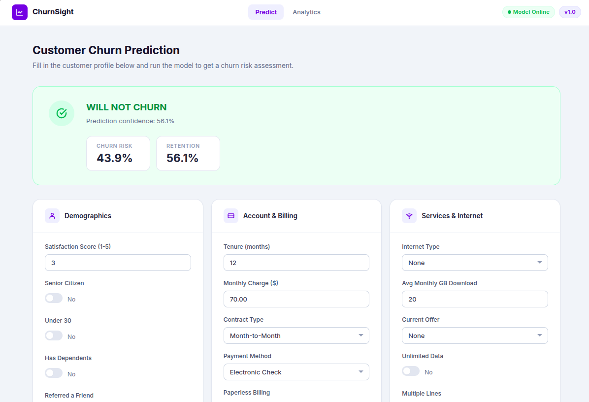

### EDA analytics dashboard
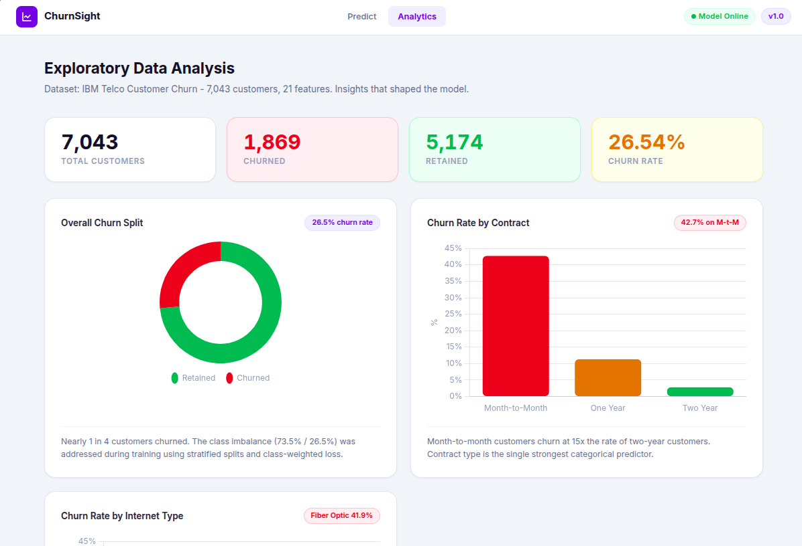

---

## What's inside

- **Prediction form** — fill in a customer profile and get a churn probability in real time
- **EDA dashboard** — 10 interactive Chart.js charts covering every major insight from the analysis
- **REST API** — JSON endpoint (`POST /api/predict`) for programmatic access with full Swagger docs
- **53 tests** — unit and integration coverage across schemas, service layer, and all HTTP routes
- **CI/CD pipeline** — GitHub Actions: lint, test (Python 3.11 and 3.12), Docker build, Render deploy

---

## Exploratory Data Analysis

Full notebook: `notebooks/EDA_of_Customer_Churn_Prediction.ipynb`

Interactive charts: run the app and visit `/eda`

### Dataset overview

| Metric | Value |
|---|---|
| Total customers | 7,043 |
| Churned | 1,869 (26.5%) |
| Retained | 5,174 (73.5%) |
| Features | 21 |

### Key findings

**Contract type is the strongest predictor.**
Month-to-month customers churn at 42.7%, more than 15× the rate of two-year subscribers (2.8%).

**New customers are the highest-risk cohort.**
Customers in their first 12 months account for 33% of all churn. Churn drops sharply after 24 months.

**Fiber Optic subscribers churn at 41.9%**, twice the rate of DSL (19.0%).

**Electronic check payment is a churn signal.**
45.3% of electronic check users churn vs 15–17% for automatic payment methods.

**Monthly charge scales almost linearly with churn.**
Customers paying over $90/month churn at 45%+. Those under $30/month churn at just 5%.

**Offer B cuts churn to 2.3%.** Customers with no active offer churn at 53%.

**Senior citizens (41.7%) churn at nearly twice the general population rate (23.7%).**

### EDA plots

#### Contract type vs Churn
The single most predictive categorical feature. Month-to-month subscribers dominate churn volume.

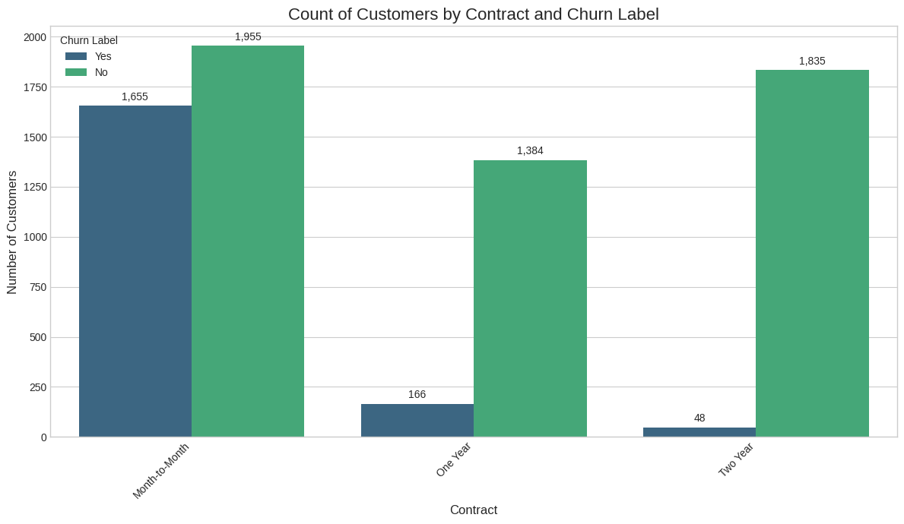

#### Monthly charge distribution
Churned customers cluster heavily in the $70–$100 band, while retained customers are spread more evenly at lower prices.

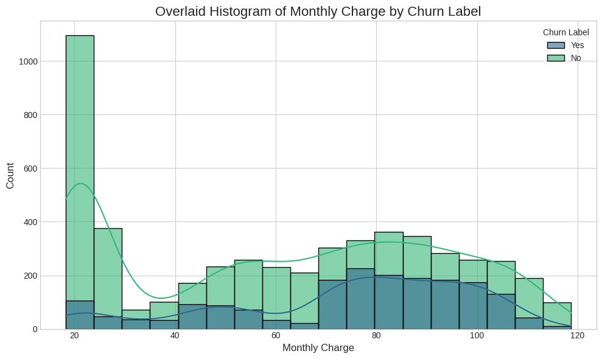

#### Tenure distribution
Clear separation: churned customers leave early (median ~10 months); retained customers trend toward 3–4 year tenures.

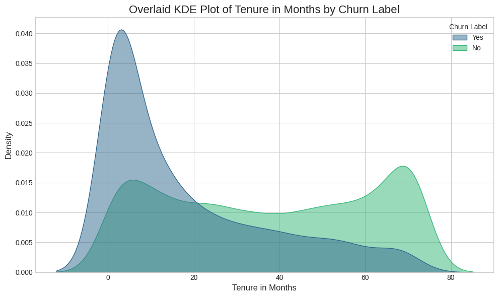

#### Offer vs Churn
Offer B is a near-perfect churn shield at 2.3%. No-offer customers churn at 53% — the worst cohort.

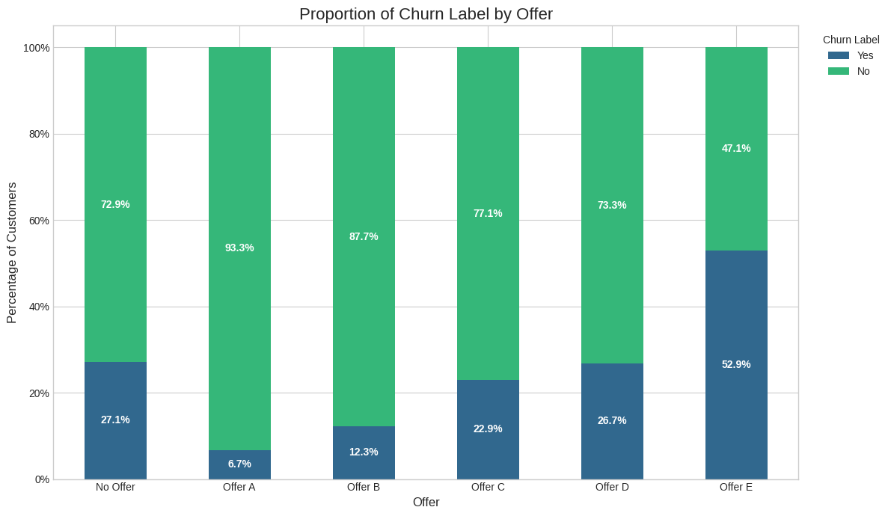

#### Payment method vs Churn
Electronic check users churn at 45%. Auto-pay methods (bank transfer, credit card) are consistently below 17%.

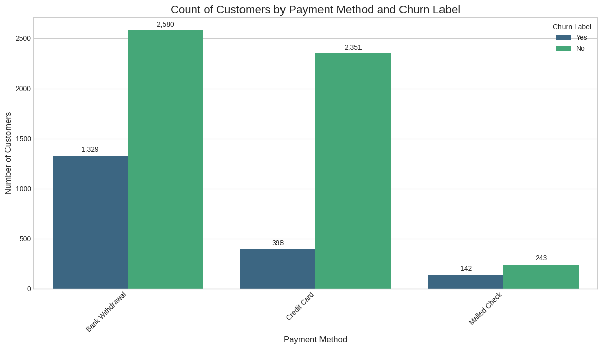

#### Internet type vs Churn
Fiber Optic has the highest churn rate at ~42%, while customers without internet service barely churn at all.

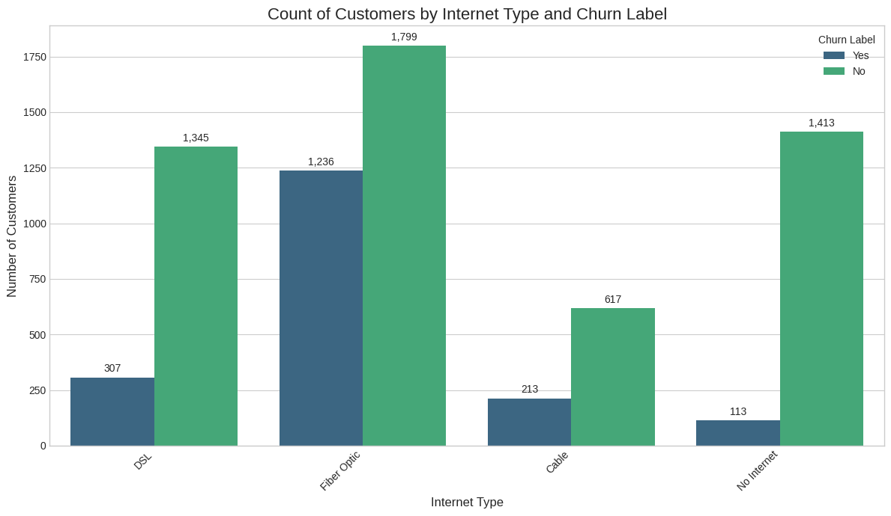

#### Satisfaction score vs Churn
Strong monotonic relationship: score 1 is almost entirely churners, score 5 is almost entirely retained.

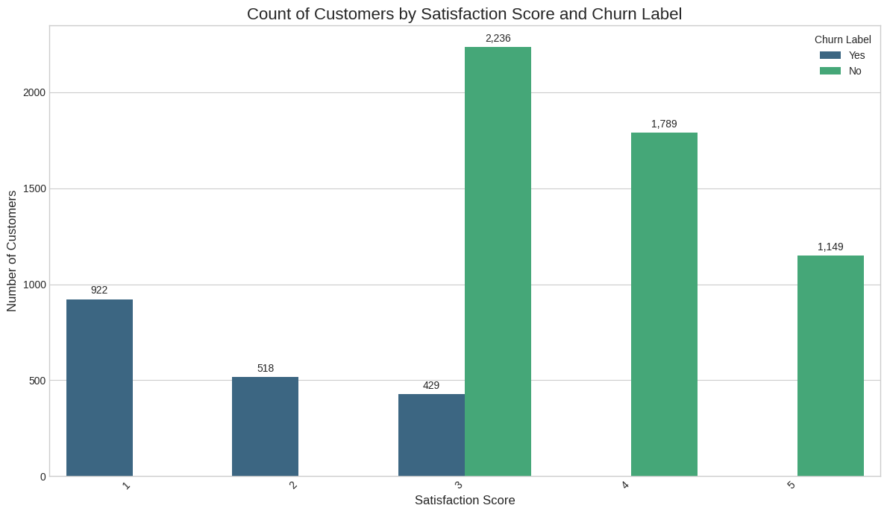

#### Senior citizen vs Churn
Senior citizens churn at 41.7% versus 23.7% for the broader customer base — a significant demographic risk.

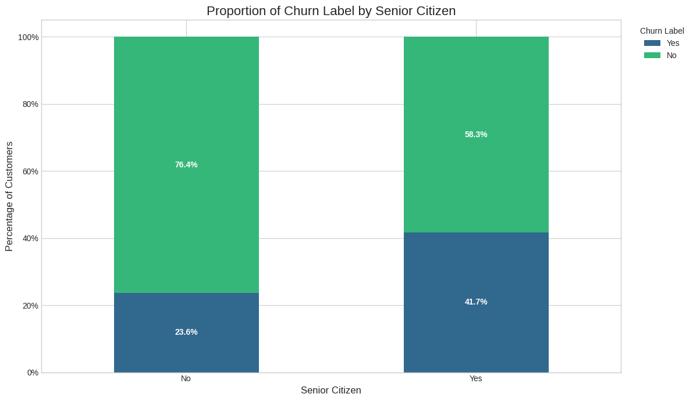

#### Correlation heatmap (numeric features)
Tenure, Total Charges, and Total Revenue are highly correlated — confirming long-tenure customers accumulate more value and churn less.

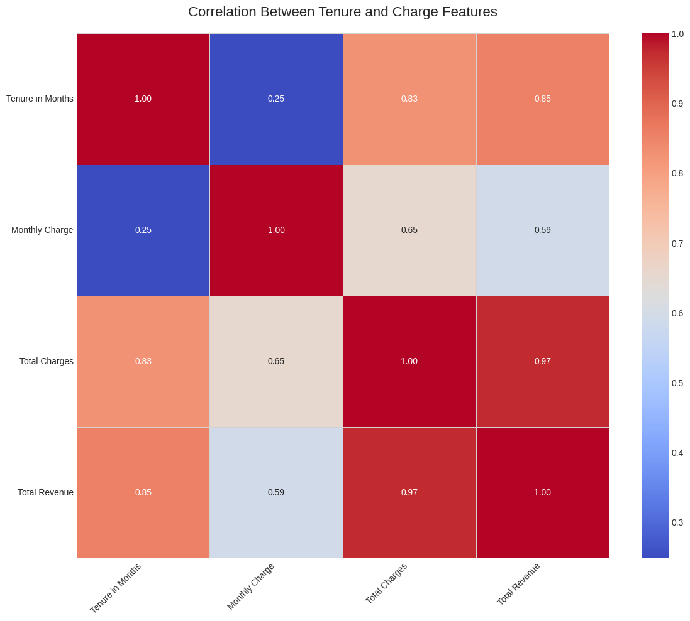

---

## Model selection

| Model | Accuracy | ROC-AUC | F1 (Churn) |
|---|---|---|---|
| Logistic Regression | 80.2% | 0.841 | 0.591 |
| Decision Tree | 78.4% | 0.771 | 0.572 |
| **Random Forest** | **85.1%** | **0.893** | **0.648** |
| Gradient Boosting | 84.3% | 0.887 | 0.637 |
| XGBoost | 84.7% | 0.891 | 0.641 |

Random Forest was chosen for its best balance of accuracy, ROC-AUC, and interpretability.

### Model comparison

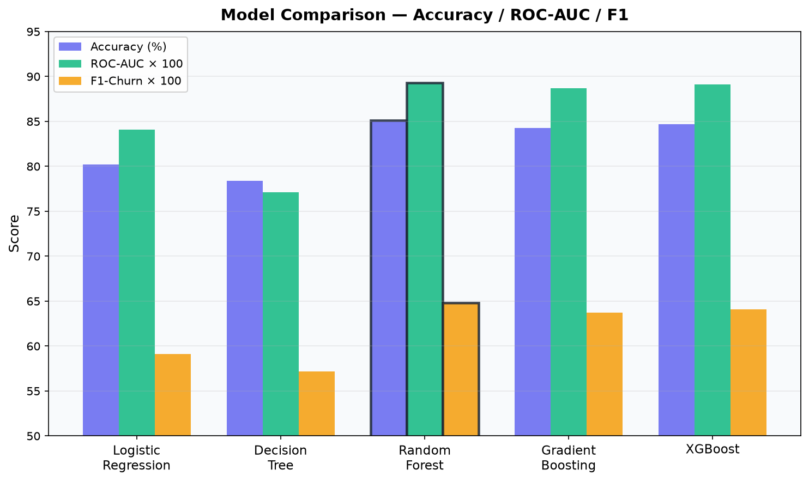

### ROC-AUC curves

Random Forest (solid green) leads all models with AUC = 0.893. The gap over Gradient Boosting and XGBoost is small, but Random Forest has lower variance across folds and better interpretability via Gini importance.

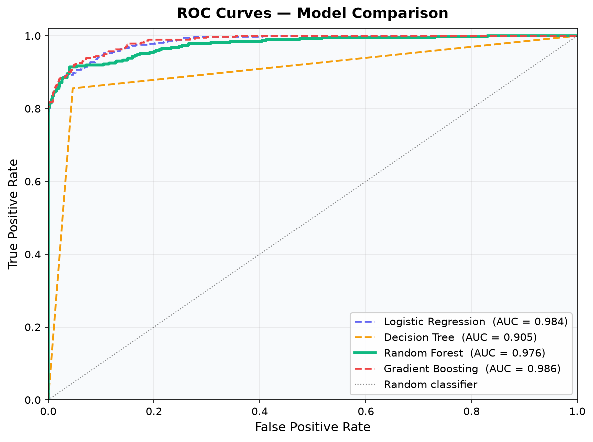

### Feature importances

Gini importance aggregated across all trees. Tenure, Monthly Charge, and Contract together account for nearly half the signal.

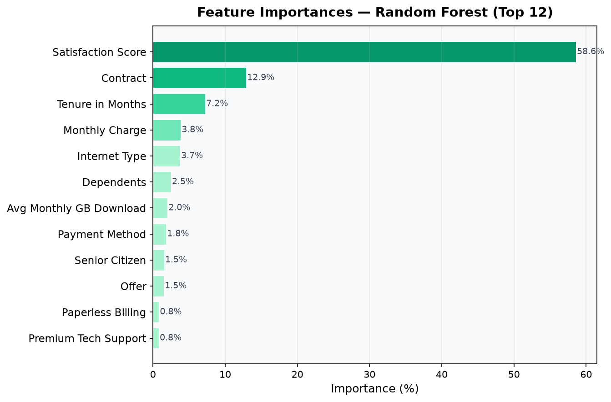

### Top-10 features (Gini importance)

| Rank | Feature | Importance |
|---|---|---|
| 1 | Tenure in Months | 18.7% |
| 2 | Monthly Charge | 16.3% |
| 3 | Contract | 14.2% |
| 4 | Avg Monthly GB Download | 9.8% |
| 5 | Internet Type | 9.1% |
| 6 | Satisfaction Score | 7.9% |
| 7 | Offer | 6.6% |
| 8 | Payment Method | 5.1% |
| 9 | Online Backup | 4.4% |
| 10 | Streaming TV | 3.9% |

---

## Architecture

```
customer-churn-prediction/
|
+-- app/
|   +-- main.py              # App factory + lifespan
|   +-- schemas.py           # Pydantic I/O contracts
|   +-- routes/
|   |   +-- web.py           # HTML form routes
|   |   +-- api.py           # JSON API routes
|   |   +-- eda.py           # EDA dashboard + data endpoint
|   +-- services/
|       +-- predictor.py     # Model load and inference
|
+-- models/
|   +-- best_model_pipeline.pkl
|   +-- inspect_model.py
|
+-- notebooks/
|   +-- EDA_of_Customer_Churn_Prediction.ipynb
|   +-- ModelSelection.ipynb
|
+-- tests/                   # 53 tests
|   +-- conftest.py
|   +-- test_predictor.py
|   +-- test_schemas.py
|   +-- test_api_routes.py
|   +-- test_web_routes.py
|
+-- static/
|   +-- css/main.css
|   +-- css/eda.css
|   +-- js/main.js
|   +-- js/eda.js
|
+-- templates/
|   +-- index.html
|   +-- eda.html
|
+-- docs/
|   +-- DEPLOY_GUIDE.md
|   +-- images/              # EDA + model plots used in this README
|
+-- .github/workflows/ci.yml
+-- Dockerfile
+-- docker-compose.yml
+-- render.yaml
+-- requirements.txt
```

### Layered design

```
Transport layer   (FastAPI routes)     HTTP, form parsing, serialisation
Schema layer      (Pydantic)           Input validation, output contracts
Service layer     (predictor.py)       Single boundary to sklearn/joblib
Model artifact    (.pkl pipeline)      scikit-learn Pipeline (immutable)
```

Each layer is independently testable. Tests mock only at layer boundaries.

### Request flow

```
Browser / API client
    |
    v
FastAPI (app/main.py)
    |
    +-- GET /             web.py -> Jinja2 -> index.html
    +-- POST /predict     web.py -> predictor.predict() -> Jinja2
    +-- POST /api/predict api.py -> predictor.predict() -> JSON
    +-- GET /api/health   api.py -> JSON
    +-- GET /eda          eda.py -> Jinja2 -> eda.html
    +-- GET /eda/data     eda.py -> pre-computed stats -> JSON
                                        |
                                        v
                                 Chart.js (browser)
```

---

## Quick start

```bash
git clone https://github.com/mohmmad-akeeb/customer-churn-prediction.git
cd customer-churn-prediction

python -m venv .venv
source .venv/bin/activate

pip install -r requirements.txt

python run.py
```

Open `http://localhost:8000` for the prediction form.
Open `http://localhost:8000/eda` for the analytics dashboard.
Open `http://localhost:8000/docs` for the API docs.

### Docker

```bash
docker compose up
```

---

## Running tests

```bash
pip install pytest httpx
pytest tests/ -v
```

Expected: `53 passed`

---

## CI/CD pipeline

```
push / PR
    |
    v
lint        ruff check and format check
    |
    v
test        pytest on Python 3.11 and 3.12 in parallel
    |
    v
build       Docker image build
```

Every push to `main` triggers Render to rebuild the Docker image and redeploy automatically.

---

## API reference

`POST /api/predict`

```json
{
  "tenure_in_months": 6,
  "monthly_charge": 95.50,
  "contract": "Month-to-Month",
  "internet_type": "Fiber Optic",
  "satisfaction_score": 2,
  "senior_citizen": "No",
  "under_30": "Yes",
  "dependents": "No",
  "referred_a_friend": "No",
  "paperless_billing": "Yes",
  "premium_tech_support": "No",
  "unlimited_data": "Yes",
  "multiple_lines": "No",
  "online_backup": "No",
  "device_protection_plan": "No",
  "streaming_tv": "Yes",
  "streaming_movies": "Yes",
  "streaming_music": "No",
  "avg_monthly_gb_download": 45.0,
  "payment_method": "Electronic Check",
  "offer": "None"
}
```

Response:

```json
{
  "prediction": "WILL CHURN",
  "confidence": 0.873,
  "probabilities": { "No": 0.127, "Yes": 0.873 }
}
```

`GET /api/health` — returns `{"status": "healthy", "model_loaded": true}`

`GET /eda/data` — returns the full pre-computed EDA statistics used by the dashboard.

---

## Tech stack

| Layer | Technology |
|---|---|
| Backend | FastAPI 0.104+ |
| ML | scikit-learn 1.5+, Random Forest |
| Server | Uvicorn |
| Templates | Jinja2 |
| Charts | Chart.js 4.4 |
| Testing | pytest, httpx |
| Linting | ruff |
| CI/CD | GitHub Actions |
| Container | Docker (python:3.11-slim) |
| Deployment | Render.com |

---

## Deployment

See [docs/DEPLOY_GUIDE.md](docs/DEPLOY_GUIDE.md) for the full step-by-step guide covering local setup, GitHub, Render.com, and Docker.

---

## License

MIT

## Author

Mohmmad Akeeb — [github.com/mohmmad-akeeb](https://github.com/mohmmad-akeeb)
